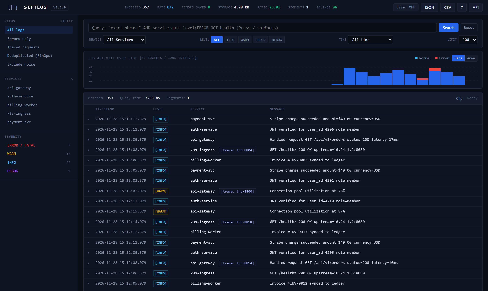

# SiftLog

[](https://github.com/gregoryz2013/SiftLog/actions/workflows/ci.yml)
[](https://github.com/gregoryz2013/SiftLog/releases)
[](LICENSE)

Single-binary C++20 log ingestion and search engine. Stores logs in Zstandard-compressed chunks with sparse metadata indexing and per-chunk Bloom filters, keeping idle RAM usage around 10 MB without inverted full-text indexes or JVM overhead.

Includes an embedded web UI, structured query parser, automatic PII/secret redaction, crash-safe WAL ingestion, and drop-in compatibility with **Vector**, **Fluent Bit**, and **Promtail** (`/loki/api/v1/push` and NDJSON).



## Quick Start

### Linux / macOS (Pre-built binary)

```sh
curl -fsSL https://raw.githubusercontent.com/gregoryz2013/SiftLog/main/install.sh | sh
siftlog --host 127.0.0.1 --port 8080 --data-dir ./data
```

Or download binaries directly from [GitHub Releases](https://github.com/gregoryz2013/SiftLog/releases) (`siftlog-linux-x86_64`, `siftlog-windows-x86_64.exe`, `siftlog-macos-arm64`).

### Docker

```sh
docker compose up -d
```

Open `http://127.0.0.1:8080` in your browser.

### Send Test Logs

```sh
curl -X POST http://127.0.0.1:8080/api/v1/logs \
  -H "Content-Type: application/json" \
  -d '[
    {"service": "api-gateway", "level": "INFO", "message": "POST /v1/checkout 200 OK", "trace_id": "trc-8812"},
    {"service": "payment-svc", "level": "ERROR", "message": "Upstream gateway timeout after 3000ms", "trace_id": "trc-8812"}
  ]'
```

## Benchmarks

Measured locally using [`tests/benchmark_ingest.py`](tests/benchmark_ingest.py) against a single `siftlog` instance (`1.21M` JSON log events ingested over HTTP keep-alive):

| Concurrency | Batch Size | Throughput |
| :--- | :---: | :--- |
| 1 worker | 1,000 | **25,590 logs/sec** (25.6k/s) |
| 4 workers | 1,000 | **64,796 logs/sec** (64.8k/s) |
| 8 workers | 2,500 | **110,582 logs/sec** (110.6k/s) |

- **Process Memory:** ~10 MB RAM idle, ~37.1 MB peak during 110k logs/sec ingestion.
- **Compression:** Typically **15x–25x** on real-world production JSON logs (e.g., Nginx, Kubernetes, application logs).

Reproduce ingestion throughput on your hardware:
```sh
python3 tests/benchmark_ingest.py
```

## Architecture & Capabilities

- **Multi-Terabyte Scale (Up to 2.5 TB+ Raw Logs):** Each compressed chunk stores a sparse index (`min_ts`, `max_ts`, `services`, `levels`) plus an **8192-bit per-chunk Bloom filter** (`1 KB`), skipping non-matching chunks without Zstd decompression. Bounded worker pools keep search memory predictable across hundreds of thousands of chunks.
- **Low Memory Footprint:** ~10 MB RAM idle, ~37 MB under load; runs comfortably on a 1 vCPU / 1 GB VPS (2–4 GB RAM recommended for multi-terabyte archives).
- **Zero External Dependencies:** Single statically linked binary (~2.2 MB) with embedded web dashboard.
- **Structured Query Syntax:** Supports exact phrases (`"connection refused"`), field filters (`service:auth level:ERROR`), and boolean operators (`AND`, `OR`, `NOT`, `!`). All JSON tokens (including nested fields) are indexed in per-chunk Bloom filters for fast chunk pruning.
- **Noise Deduplication:** Sliding-window aggregation collapsing repeated identical logs into single entries with `repeat_count` counters.
- **Distributed Trace Waterfall & RCA:** Log-based trace stitching (`trace_id`) with Gantt waterfall view and automated root-cause cascade detection.
- **PII & Secret Redaction:** Automatically masks passwords, bearer/JWT tokens, API keys, payment cards, and passport/SNILS numbers before writing to disk.
- **Fluent Bit & Vector Compatible:** Native Loki Push API (`/loki/api/v1/push`), JSON arrays, and NDJSON (`/api/v1/logs`).
- **S3 Offloading & Retention:** Non-blocking chunk sync to S3-compatible storage (AWS S3, MinIO, Yandex Cloud) and automated pruning (`--retention-days`).
- **Alerting & Security:** Sliding-window error spike detection with Telegram Bot API notifications, HTTP Basic Auth, `X-Forwarded-For` / `X-Real-IP` support, `/health` probe, and SHA-256 hash-chained audit trail.

## Durability & Crash Safety

- **Write-Ahead Log (WAL):** Incoming log batches are appended and flushed to `<data-dir>/wal.log` before ingestion returns `200 OK`.
- **Atomic Chunk Commits:** Background flushes rotate `wal.log` → `wal.flushing`, write compressed data to `.zst.tmp` and metadata to `.meta.tmp`, atomically `rename` them into place, and only then delete `wal.flushing`.
- **Startup Recovery:** On startup, any leftover `.tmp` files are cleaned up and any uncommitted records in `wal.flushing` or `wal.log` are automatically replayed into compressed chunks.

## Known Limitations & Trade-offs

- **Single-node architecture:** SiftLog does not currently support multi-node clustering or automatic replication. For high availability, run behind a reverse proxy with disk snapshots or S3 offloading.
- **Query language scope:** The query parser supports boolean text search (`AND`, `OR`, `NOT`), exact phrases, and `key:value` filters. It does not yet support aggregation pipelines (`stats`, `count by`, `rate`, regex extraction on the fly) like Grafana Loki or VictoriaLogs.
- **Wide-range scans:** Bloom filters skip irrelevant chunks for specific tokens/IDs, but queries without selective terms (e.g., scanning all `INFO` logs across 100 GB of matching chunks) still decompress and scan matching Zstd chunks.

## Log Shipping Integrations

### Vector

```toml
# vector.toml
[sources.app_logs]
type = "file"
include = ["/var/log/app/*.log"]

[sinks.siftlog]
type = "loki"
inputs = ["app_logs"]
endpoint = "http://127.0.0.1:8080"
compression = "none"

[sinks.siftlog.labels]
service = "{{ service }}"
level = "{{ level }}"
```

### Fluent Bit

```ini
# fluent-bit.conf
[SERVICE]
    Flush        1
    Log_Level    info

[INPUT]
    Name         tail
    Path         /var/log/containers/*.log
    Parser       docker
    Tag          kube.*

[OUTPUT]
    Name         loki
    Match        *
    Host         127.0.0.1
    Port         8080
    Labels       job=fluentbit
```

## Configuration

| Flag | Environment Variable | Default | Description |
| :--- | :--- | :--- | :--- |
| `--host` | `SIFTLOG_HOST` | `0.0.0.0` | Bind IP (`127.0.0.1` recommended behind reverse proxy) |
| `--port` | `SIFTLOG_PORT` | `8080` | Listen port |
| `--data-dir` | `SIFTLOG_DATA_DIR` | `./data` | Storage directory for compressed chunks |
| `--retention-days` | `SIFTLOG_RETENTION_DAYS` | `0` | Auto-prune chunks older than N days (`0` = disabled) |
| `--auth-user` | `SIFTLOG_AUTH_USER` | `""` | HTTP Basic Auth username (empty = open) |
| `--auth-password` | `SIFTLOG_AUTH_PASSWORD` | `""` | HTTP Basic Auth password |
| `--no-mask-pii` | `SIFTLOG_MASK_PII` | `enabled` | Disable automatic PII and secret redaction |
| `--no-noise-dedup` | `SIFTLOG_NOISE_DEDUP` | `enabled` | Disable sliding-window noise deduplication |
| `--noise-window` | `SIFTLOG_NOISE_WINDOW` | `5` | Deduplication sliding window in seconds |
| `--s3-endpoint` | `SIFTLOG_S3_ENDPOINT` | `""` | S3 endpoint (e.g. `s3.amazonaws.com`, `storage.yandexcloud.net`) |
| `--s3-bucket` | `SIFTLOG_S3_BUCKET` | `""` | S3 bucket name for chunk offloading |
| `--s3-region` | `SIFTLOG_S3_REGION` | `us-east-1` | S3 region |
| `--s3-access-key` | `SIFTLOG_S3_ACCESS_KEY` | `""` | S3 Access Key ID |
| `--s3-secret-key` | `SIFTLOG_S3_SECRET_KEY` | `""` | S3 Secret Access Key |
| `--s3-prefix` | `SIFTLOG_S3_PREFIX` | `siftlog` | S3 object key prefix |
| `--audit-log` | `SIFTLOG_AUDIT_LOG` | `<data-dir>/audit.log` | Audit trail output path |
| `--error-threshold` | `SIFTLOG_ERROR_THRESHOLD` | `10` | Error spike threshold per service per 60s window |
| `--tg-token` | `SIFTLOG_TG_TOKEN` | `""` | Telegram Bot API token for alerts |
| `--tg-chat-id` | `SIFTLOG_TG_CHAT_ID` | `""` | Telegram chat ID |

## API Reference

- `POST /api/v1/logs` — Ingest single JSON object, JSON array, or NDJSON (`application/x-ndjson`).
- `POST /loki/api/v1/push` — Loki-compatible push endpoint (returns `204 No Content`).
- `GET /api/v1/search` — Query search (`q`, `service`, `level`, `from`, `to`, `limit`).
- `GET /api/v1/histogram` — Time-bucketed log volume and error counts (`q`, `service`, `level`, `from`, `to`, `step`).
- `GET /api/v1/stats` — Storage size, compression ratio, known services, and recent alerts.
- `GET /health` — Public health check endpoint (`{"status":"ok"}`).

## Reverse Proxy & Systemd

Configuration templates are included in `deploy/`:
- `deploy/nginx/siftlog.conf`
- `deploy/apache/siftlog.conf`
- `deploy/systemd/siftlog.service`

## Build from Source

Requires a C++20 compiler, CMake 3.25+, and Ninja. Dependencies (`zstd`, `cpp-httplib`, `nlohmann/json`) are fetched automatically via CMake `FetchContent`.

```sh
cmake -B build -G Ninja -DCMAKE_BUILD_TYPE=Release
cmake --build build --config Release
```

Run the integration test suite:

```sh
python3 tests/verify_mvp.py
```

## License

Apache License 2.0. See [LICENSE](LICENSE).
